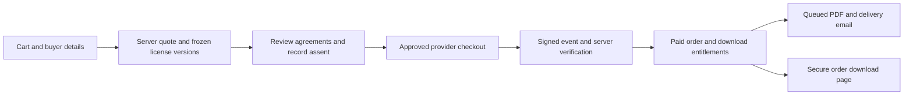

# Joel Tracks backend plan

Prepared November 18, 2026; reviewed November 19; implementation status updated November 23, 2026. This remains the architecture plan; the guest order-access foundation, R2 storage provisioning and seller password/TOTP authentication with a private order overview and resumable private draft uploads are implemented so far. The seller approved a separate Supabase Free project in MBUGUA BUILDERS / US East at the quoted $0/month and local work without a domain. That project and its private schema now exist. The storefront subsequently deployed through its Git-connected Vercel project. With explicit seller approval, R2 Standard buckets were provisioned on November 23; details are in docs/STORAGE.md. A domain, live emails/payments, public catalog publication and a Cloudflare backend deployment remain pending. Draft uploads are implemented on Vercel; see docs/UPLOADS.md. Seller access now runs through the existing Vercel Hono function; see docs/SELLER_ACCESS.md. See [the implementation status and activation requirements](docs/ORDER_ACCESS.md). The supplied review is advisory input, not approval of new business policies. Section 12 records its disposition.

## 1. Confirmed scope

JT operates from Kenya as an individual, has no USD bank account, targets U.S. buyers and has a backend budget up to US$50 per month. PayPal is an option the seller has asked us to consider, not an approved final provider. A domain has not been purchased. Preserve the selected Soft Seal logo and current shopping/listening experience.

Launch planning: approximately 30 beats with daily additions; MP3s 3–5 MB, WAVs 30–40 MB, stems ZIPs 100–200 MB. Customers hear clean, full-length previews. Basic $50 / MP3; Premium $100 / MP3+WAV; Unlimited $500 / MP3+WAV+stems; Custom has negotiated price, delivery and splits. Saved seller settings are authoritative. Exactly two valid cart beats receive 15% off; three or more receive 25%, without stacking those rates. Current promotion includes agreed custom offers.

Required production capabilities: seller-only access; uploads and file editing; catalog/tags/search; favorites/cart; license editing and versioning; custom negotiations; checkout/payment; agreement review and generation; post-payment download/email delivery; seller payments and purchase tally; notification counters and statistics; contact forms; newsletter subscriptions; blog publishing and featured-beat settings.

Outstanding business decisions remain explicit in section 11. The recommendations below do not choose contractual rights or settlement policy on the seller's behalf.

### Proposed launch boundary, pending seller approval

The full feature list above remains the product scope. Recommend a first production release with the three fixed tiers, catalog/search/tags, player, favorites/cart, seller uploads/rights records/license management, server quotes, contract review, one payment provider, secure delivery/recovery, contact enquiries, payment statistics, accounting export and operational alerts. Notification counters can use polling. Seller authentication, backups and failed-order recovery are launch requirements.

Recommend placing online Custom negotiation/payment, blog publishing, newsletter collection/campaigns and synchronized buyer accounts in a subsequent release. Do not silently remove or leave misleading functional controls: if this release boundary is approved, Custom should clearly lead to an enquiry rather than an automated sale, and unconnected subscription/publishing controls should have an honest unavailable state. This scope reduction is a proposal, not a confirmed change. If Custom checkout is required at launch, its thread access and conditional exclusivity lifecycle below become launch requirements, with additional effort.

## 2. Recommended stack

| Layer | Recommendation | Reason |
| --- | --- | --- |
| Frontend and API hosting | Cloudflare Workers + Static Assets; TypeScript API using Hono | Serve the existing frontend and API from one origin, with small server handlers. Preserve the UI rather than undertake a framework rewrite. [Workers pricing](https://developers.cloudflare.com/workers/platform/pricing/), [Hono on Workers](https://hono.dev/docs/getting-started/cloudflare-workers). |
| Database and identity | Supabase PostgreSQL + Auth, Pro for live selling | Relational order/contract records, managed seller authentication and database backups. Use Free for development; production should avoid its inactivity pausing. Pro starts at $25/month, includes one Micro project's compute credit and daily backups retained seven days. [Pricing](https://supabase.com/pricing), [production guidance](https://supabase.com/docs/guides/deployment/going-into-prod). |
| Audio, images and contract documents | Cloudflare R2 Standard | Public previews/thumbnails separate from private paid assets and buyer documents. Large-file support and free direct egress fit browser listening. [Pricing](https://developers.cloudflare.com/r2/pricing/), [limits](https://developers.cloudflare.com/r2/platform/limits/), [temporary access](https://developers.cloudflare.com/r2/api/s3/presigned-urls/). |
| Payment provider | PayPal Checkout as the first USD candidate, conditional on Kenyan merchant-account approval; Paystack Kenya as an alternative | PayPal can separate USD customer checkout from KES withdrawal through Equity. Confirm Business-account eligibility and enabled live Checkout features before choosing it. Paystack supports KES settlement without a USD payout account. Start with one approved provider. See the comparison below. |
| Transactional email | Resend Free initially | Delivery links, receipts, auth mail and contact forwarding from a verified domain. Put a small mail-service boundary in the code so the provider can change without rewriting checkout. [Pricing](https://resend.com/pricing?product=transactional), [domain verification](https://resend.com/docs/dashboard/domains/introduction). |
| Durable background work | Cloudflare Queues + database outbox | Retry document generation, email and payment reconciliation without blocking checkout. Queue messages contain record IDs, not audio bytes. [Pricing](https://developers.cloudflare.com/queues/platform/pricing/). |
| PDF rendering | Versioned HTML templates + Cloudflare Browser Run PDF endpoint | Generate readable agreements from the same frozen content reviewed in checkout. Paid Workers includes a browser-hours allowance. [PDF endpoint](https://developers.cloudflare.com/browser-run/quick-actions/pdf-endpoint/), [pricing](https://developers.cloudflare.com/browser-run/pricing/). |
| Form abuse protection | Turnstile + server-side rate limits | Protect enquiries, newsletter confirmations and order-link recovery. Challenge validation happens on the server. [Turnstile plans](https://developers.cloudflare.com/turnstile/plans/). |
| Independent backups | Encrypted database dumps and immutable-asset copies in a private Backblaze B2 bucket, plus an offline restore key | Proposed separate provider/account, with recovery tests; not a second bucket under the production Cloudflare account. See section 9. |
| Monitoring | Workers structured error logs, persistent failure records and UptimeRobot external checks | Proposed small-store setup: job alerts plus independent endpoint checks. See section 9 for thresholds, limits and costs. |

These are modular services around one application, not a fleet of independent microservices. Use SQL migrations, pinned dependencies, a committed lockfile and automated checks. No Elasticsearch, separate analytics warehouse or automatic audio-transcoding service is needed at launch.

**Conscious infrastructure choice:** retain Queues and Browser Run at launch. Queues provides retry/dead-letter handling for payment-related work; Browser Run reuses the accessible, paginated agreement HTML instead of maintaining a separate PDF layout. Both are capabilities of the existing Cloudflare account and have included allowances in the current estimate. A scheduled Worker dispatches the transactional outbox and reconciles stuck jobs; it is not a substitute for durable job records. A cron-only dispatcher/worker and a PDF library could reduce bindings, but would require implementing equivalent leases, retries, failure visibility and document pagination. Do not build both alternatives. Reassess only if a sandbox spike shows deployment or quota costs exceed their benefit.

### Alternatives considered

- **Supabase Storage:** simplifies configuration and its paid allowance could accommodate the initial catalog. R2 is recommended for audio because preview/download traffic does not incur direct R2 egress charges; the tradeoff is maintaining separate bucket configuration.
- **Cloudflare D1 plus a separate auth library:** can lower fixed costs, but moves more identity/session maintenance into this application. Supabase Pro fits the stated budget and gives a conventional PostgreSQL database and managed Auth.
- **Flutterwave Kenya:** a payment fallback if onboarding or supported account features make Paystack unsuitable. Its published Kenya fees are 3.2% local cards, 4.8% international cards and 2.9% mobile money, excluding applicable taxes; international cards default to local-currency charging/settlement. [Official pricing](https://www.flutterwave.com/ke/pricing).

### Payment choice for an individual without a USD bank account

Checked November 18, 2026. The recommendation is to evaluate PayPal first for the existing USD prices, with the following account checks before committing to an integration. This is not a finding that the seller's account is already eligible.

| Option | Verified practice | Implication for JT |
| --- | --- | --- |
| PayPal Checkout | PayPal's Kenya help lists Checkout among Business-account products. Its Kenya onboarding page mentions solopreneurs, but also lists registration and business-bank details among requirements. [Account types](https://www.paypal.com/ke/cshelp/article/what-is-the-difference-between-personal-and-business-accounts%E2%80%AF-help318), [Kenya onboarding](https://www.paypal.com/ke/business/open-business-account). | Confirm the account category and documentation PayPal accepts for this individual seller, plus live API/Checkout access. Do not assert that a personal account is sufficient or that incorporation is automatically required. |
| PayPal withdrawal via Equity | Equity documents linking PayPal and withdrawals into either KES or USD Equity accounts. [Official service](https://equitygroupholdings.com/ke/pay-send-money/personal/payment-services/paypal/). | An eligible linked KES Equity account provides a documented route without opening a USD account. This does not establish that the seller already has an Equity account. Confirm actual withdrawal fees and FX quote before selecting the route. |
| Paystack Kenya with KES settlement | Kenyan merchants can accept international cards, subject to activation, and charge/settle KES. USD settlement requires a matching USD account at a Kenyan bank. Starter payout rules allow a personal account matching the owner's identification; the published Starter lifetime collection limit is KES 600,000. [International payments](https://support.paystack.com/en/articles/2130690), [payout requirements](https://support.paystack.com/en/articles/2125314). | No USD account does not rule out Paystack. Keeping USD display prices while charging KES requires an approved conversion/rounding policy and an explicit final KES quote before assent and payment. Confirm individual onboarding, international-card activation and growth path. |

PayPal's Kenya commercial-fee page, updated October 28, 2026, lists Kenya in the applicable markets. Its international table places Kenya in the residual 4.40% + fixed-fee group; the USD fixed fee is $0.30. Thus a standard $100 U.S.-buyer payment received in USD has a $4.70 receiving fee before conversion/withdrawal costs or any account-specific agreement. Domestic rates and U.S.-merchant rates are different and must not be substituted. [Kenya fee schedule](https://www.paypal.com/ke/business/paypal-business-fees).

Guest card checkout availability must be tested for the actual merchant account, integration and buyer context; do not promise that every customer can pay without a PayPal account. The Kenya help documents guest checkout and verification/settings requirements, but this is not proof of universal availability or eligibility for advanced card processing. [Kenya guest-checkout guidance](https://www.paypal.com/ke/cshelp/article/how-do-i-accept-credit-cards-using-guest-checkout-with-paypal-express-checkout-ts1623).

**Recommendation:** keep USD as the proposed checkout currency if PayPal onboarding and withdrawal checks succeed. Choose Paystack KES instead if its individual onboarding and card experience better meet the seller's needs and the seller approves a KES quote policy. Do not build both providers at launch by default. No current PayPal-to-M-PESA route or fee is asserted here; the Equity route is the one verified for this comparison.

## 3. Budget and verified allowances

Existing provider pricing below was checked against official sources on November 18, 2026; new backup/monitoring details and targeted technical/legal corrections were checked November 19, 2026. The review PDF explicitly did not re-check provider prices and is not the source for those figures. Allowances are not guarantees that usage stays free.

| Item | Planning amount | Relevant limit or condition |
| --- | ---: | --- |
| Workers Paid | $5/month base | Includes 10 million dynamic requests and 30 million CPU milliseconds monthly; static-asset requests are free. Usage above allowances is billed. |
| Supabase Pro | $25/month base | One Micro production project assumed. Extra projects/compute/add-ons can increase the bill. Development/staging can initially use a separate Free project. |
| R2 Standard | $0 initially within allowances; reserve $0–$3/month for early growth | 10 GB-month storage, 1 million Class A and 10 million Class B operations included monthly. Standard storage beyond that is $0.015/GB-month, with additional operation charges. Direct egress is free. |
| Resend Free | $0 within allowance | 3,000 transactional emails/month, maximum 100/day. Count all recipients, auth emails and contact forwards, not just orders. |
| Queues | No additional cost assumed at launch | Workers Paid includes 1 million operations/month. A normal message delivery uses three operations; retries add usage. |
| Browser Run PDF | No additional cost assumed at launch | Workers Paid includes 10 browser hours/month; Quick Actions bill browser hours, with additional hours at $0.09/hour. |
| Turnstile Free | $0 | Suitable for this initial form-protection requirement. |
| Independent backup storage | Reserve $1–$3/month initially | B2 publishes $6.95/TB per 30 days for U.S. West, with the first 10 GB free; regions/contracts can vary. At that rate, 100 GB total is about $0.63/month after the allowance, before operations/restore traffic. Retained dumps, document versions and masters all consume storage. [Pricing](https://www.backblaze.com/cloud-storage/pricing), [provider-readable rates](https://www.backblaze.com/pricing.md). |
| External uptime monitoring | $0 within UptimeRobot Free limits | Official help permits commercial use and lists 50 monitors with 5-minute checks. Use email alerts initially; no paid SMS, faster checks or synthetic-checkout feature is assumed. [Free-plan conditions](https://help.uptimerobot.com/en/articles/11604710-who-should-use-uptimerobot-s-free-plan). |
| Backup runner | $0 additional assumed only within an existing included runner allowance | Proposed scheduled private GitHub Actions Linux job; runner, cache and artifact usage must be checked against the actual account. No unlimited free private CI is assumed, and backups are uploaded to B2 rather than retained as CI artifacts. Reserve budget or select another runner if the allowance is insufficient. [Billing](https://docs.github.com/en/billing/concepts/product-billing/github-actions). |
| Domain | Annual purchase, separate from monthly service billing | Porkbun lists a standard .com registration/renewal at $11.81/year when checked. Availability, premium-name pricing and the actual checkout quote still need confirmation. [Price list](https://porkbun.com/products/domains/tld_pricing). |

Expected light-usage infrastructure: approximately **$32–$37/month including independent-backup reserve and the annualized standard-domain example**, before taxes and payment charges. Budget around $40 to retain some headroom within the $50 ceiling; monitoring and runner use are assumed within verified/actual free allowances. The domain is billed annually upfront, not monthly. This estimate excludes development labor, legal/accounting work, FX, optional paid mailbox, offline backup hardware and an optional marketing-mail provider. No premium domain is assumed. Recalculate if retention, daily uploads, CI or monitor requirements grow.

Payment charges are separate from the infrastructure estimate. PayPal's standard international receiving-fee example is $4.70 on $100 received in USD; conversion and withdrawal can add costs. Paystack has no upfront/monthly fee on its published standard Kenya offering and lists 2.9% local cards, 3.8% international/USD cards and 1.5% M-PESA. The 3.8% percentage alone is $3.80 on an equivalent $100 charge, but KES charging, taxes and FX can change the comparison. Confirm account-specific terms and actual settlement/withdrawal quotes before activation. [PayPal Kenya fees](https://www.paypal.com/ke/business/paypal-business-fees), [Paystack pricing](https://paystack.com/ke/pricing), [fee table](https://support.paystack.com/en/articles/2130306).

The files imply roughly 4.0–7.4 GB for 30 beats before extra preview copies, thumbnails, documents and retained revisions. Regular uploads can exceed R2's included storage within weeks. As a storage-only illustration, 50–100 GB at the published Standard rate is approximately $0.60–$1.35/month above the 10 GB allowance, excluding operations. Keep original masters backed up separately.

Resend Pro is currently $20/month: adding it would consume the remaining budget and can take this stack above $50. Before hitting the Free daily/monthly limits, evaluate Amazon SES usage-based email instead. Its à-la-carte outbound price is $0.10 per 1,000 emails plus data/optional feature charges, but production access must be approved; sandbox access cannot serve arbitrary buyers. This is a growth option, not an activated fallback. [Resend plans](https://resend.com/pricing?product=transactional), [SES pricing](https://aws.amazon.com/ses/pricing/), [production access](https://docs.aws.amazon.com/ses/latest/dg/request-production-access.html).

Reserve this transactional allowance for purchase/delivery/recovery, seller authentication, offer messages, contact forwards and operational alerts. Never send newsletter campaigns through this transactional quota. Marketing requires a separately budgeted provider/allocation, consent and compliance setup. A separate domain or API key alone does not create a separate free quota. Track all recipients, prioritize delivery/recovery, deduplicate alerts and display queued/retry status before hitting the daily cap.

Set budget/usage alerts and application rate limits. Metered providers are not a hard all-in $50 spending cap. Payment fees scale with sales. Email and document quotas must produce visible retryable failures, not lost orders.

## 4. File upload and catalog

1. Authenticated seller requests an upload slot with beat ID, asset type, expected size and MIME type.
2. API checks seller authorization, permitted formats and limits, and returns short-lived scoped R2 upload permission. Audio goes directly from the browser to R2, avoiding application-server upload limits. Although a single PUT can fit 200 MB, use multipart upload for large files. Proposed threshold: 50 MiB, with 10 MiB parts and bounded concurrency; tune after testing the seller's connection. Server owns upload IDs, permitted keys and completion, and signs only the required part requests. Save completed part numbers/ETags in the upload record, retry failed parts, renew expired permissions and allow resume after reselecting the matching local file. Never treat a multipart ETag as the original file's SHA-256 checksum. [R2 upload guidance](https://developers.cloudflare.com/r2/objects/upload-objects/).
3. Assets initially remain unpublished. Finalization verifies the object exists, expected size and allowed file header/type, and records an immutable asset version and checksum. Validate the manifest and completed parts, reject mismatched/replaced local files, and compute or verify a real content checksum without buffering the entire file in a Worker. Configure CORS only for the actual storefront/admin origins, including the headers needed for part upload/ETag access.
4. Publishing checks a playable preview and derives license availability per beat from finalized, verified delivery assets. Basic requires MP3; Premium requires MP3 + WAV; Unlimited requires MP3 + WAV + stems, following each tier's configured delivery list. Missing WAV disables Premium and Unlimited; missing stems disables Unlimited. A lower tier may remain available when its complete package exists. Pending, failed, empty or interrupted uploads do not qualify. Recompute after asset changes; expose only boolean `fileAvailability` flags for MP3/WAV/stems in the public catalog, never private keys. Upload intent, filenames and browser-supplied flags are not proof of completion. Recheck authoritative assets at quote/checkout before charging, reject unavailable tiers and invalidate affected unpurchased quotes/cart choices without silently substituting another license. Custom licensing remains negotiated. Abandoned upload objects are cleaned up.
5. Replacing artwork or audio creates a new version. Purchased items retain references to their original deliverables. Prevent accidental deletion of assets needed by paid orders.

Abandoned multipart sessions need a documented expiry, explicit abort control and scheduled/lifecycle cleanup; cleanup must not delete published or purchased asset versions. Stage 2 includes interruption, expired permissions, browser refresh/reselection and resumed 200 MB upload tests, rather than only a happy-path upload.

**Approved preview choice, November 23:** use the uploaded delivery MP3 itself as the full-length clean, untagged preview. Do not require a separate preview upload or transcode/change its bitrate. The future authenticated upload pipeline retains the paid MP3 version privately and makes a byte-identical preview copy in the media bucket only after validation and publication; no extra seller upload is needed. The public copy will be downloadable by listeners once preview delivery is enabled. WAVs, stems and buyer agreements stay private. This choice supersedes the earlier proposed 160 kbps preview profile; see docs/STORAGE.md for provisioned infrastructure and pending upload integration.

**Optional local preparation, requiring later approval:** a seller-run helper could produce upload manifests/checksums and batch-match files. The earlier suggestion to generate a separate preview with FFmpeg is superseded by the approved use of the uploaded MP3 unchanged. Any future WAV-to-MP3 preparation would need separate approval and would use that same resulting MP3 for preview and delivery. Offer batch selection/auto-matching in the dashboard for preview, WAV, stems and artwork. Keep manual upload available. This is an optional workflow improvement requiring seller approval, with no hosted transcoding service and no destructive overwriting of masters. Keep ZIPs as archives rather than extracting them in a request handler. Seller-only upload validation is not a claim of comprehensive malware scanning.

Public delivery includes only approved preview MP3 copies (using the uploaded MP3 unchanged) and thumbnails, preferably on a custom media domain with caching and audio range support. WAVs, stems, paid delivery copies, agreements and buyer records stay private. A clean full-length browser preview can be copied; access controls cannot turn it into copy-proof audio.

PostgreSQL stores beat metadata, tags, availability and featured selection. Start with indexed title/tag queries and pagination; add full-text indexes as useful. Public endpoints expose published catalog fields only, never private asset keys or order/customer data.

Add a private per-beat rights record: creator/collaborator identities and agreed shares, sample/loop provenance and applicable clearance/licensing evidence, restrictions, prior nonexclusive/exclusive grants, publishing/admin commitments and seller attestation/date. Link evidence to the beat version; publication requires review of missing/conflicting rights, not a fabricated clearance checkbox. These private records support counsel's review and must not leak collaborator documents publicly. They do not themselves prove a valid chain of title.

## 5. Seller identity, buyer access and existing features

The current `#studio` hash is a frontend route and cannot itself be protected by the server. Move the real dashboard to `/studio/` with authenticated responses, seller authorization on every admin API, and RLS as defense in depth. Restrict seller access to one explicitly provisioned account, require TOTP MFA, and derive authority from protected server records. Hiding links is not authorization. Keep service credentials in server secrets.

### Explicit auth and data-access model

- The browser calls the same-origin Hono API for application data and seller login/MFA. It does not call Supabase Auth/Data APIs directly and stores no Supabase tokens or service keys in localStorage. Direct scoped browser-to-R2 **uploads** are the deliberate exception; public media remains public.
- Hono forwards seller credentials/challenges to Supabase Auth over HTTPS. After verified identity and MFA, issue an opaque, high-entropy session ID in a `__Host-` cookie (`Secure`, `HttpOnly`, `SameSite=Lax`, path `/`, no Domain). Store its hash and session expiry/revocation state in PostgreSQL, with Supabase refresh/access credentials encrypted server-side under a managed secret. The session is a custom backend-for-frontend integration to implement and test, not a default Supabase feature. Rotate on login/MFA/recovery, serialize refreshes and enforce idle/absolute expiry. Require CSRF/origin checks on mutations.
- Server validation checks seller identity against the protected allowlist and the required verified MFA assurance, not editable user metadata or a cookie's mere presence. Logout/recovery revokes application sessions and upstream refresh sessions. Sensitive operations recheck authorization and session validity. No self-service seller registration.
- Workers use pinned `supabase-js` over HTTPS to Supabase's Data API/PostgREST; no direct PostgreSQL sockets or Hyperdrive at launch. Seller queries carry the verified seller JWT so narrowly granted RLS policies apply. Public/guest routes use narrowly scoped server RPCs/views and capability validation. Privileged payment/outbox RPCs require server-held credentials and perform a whole transaction in PostgreSQL; a sequence of independent HTTP calls is not one transaction.
- Exposed tables/functions start with no anonymous grants and RLS deny-by-default; allow only the necessary seller/AAL2 operations. Keep sensitive storage in private schemas where practical. Revoke default function execution and grant it deliberately. Service-role/background access bypasses RLS, so its authorization comes from server code and tightly scoped RPC interfaces; do not claim RLS protects calls made with that role. Verify no unintended direct Data API access. [Supabase API security](https://supabase.com/docs/guides/api/securing-your-api), [server-side auth](https://supabase.com/docs/guides/auth/server-side/advanced-guide).

### Seller recovery

Before launch, enroll and test a second TOTP factor on a separately secured device, and document recovery of the Supabase/Cloudflare owner accounts. Supabase currently supports multiple MFA factors but **does not supply native recovery codes**; do not promise them. Recommend this second-factor path instead of adding a bespoke MFA bypass. [MFA reference](https://supabase.com/docs/reference/javascript/auth-mfa).

Document a manual break-glass procedure controlled through the protected infrastructure owner account: verify seller identity outside the storefront, audit the action, revoke existing sessions, reset/re-enroll factors and rotate affected secrets. Password reset or access to the contact inbox alone must not bypass MFA. Test a lost-primary-phone scenario, protect offline recovery material and keep recovery privileges out of public API routes.

**Confirmed buyer model (November 23):** guest checkout plus secure, order-scoped email access links. The seller asked to start implementation. Optional passwordless accounts for cross-device favorites and full purchase history remain a later decision. Favorites/cart stay in a separate browser namespace; old prototype records are not imported as live data. Access tokens, server sessions, an email outbox and download authorization are implemented; email/provider/R2 configuration and verified checkout are not active yet.

### Returning to Custom offers without an account

When Custom negotiation is enabled, recommend a separate email-verified capability for each thread. Store only token hashes, scope them to that thread and permitted buyer actions, exchange them for a short-lived same-origin HttpOnly session, and support revocation/rotation plus rate-limited reissue to the verified email. A thread ID or checkout order link alone grants no offer access. An emailed GET must not consume a one-use credential or accept terms: require an explicit POST exchange so mail-scanner link visits cannot accept an offer. Prevent tokens leaking into analytics, referrers and logs; remove them from the address bar after exchange.

Quote/payment validates the explicitly accepted current offer revision, its email-bound buyer, files, splits and expiry. Old counteroffers cannot be paid. Link/session expiry and recovery windows remain proposed policies for seller approval. This resolves continuity over multiple days without quietly requiring buyer accounts. Passwordless buyer accounts remain an alternative if the seller prefers them, not a second mechanism to build in parallel.

| Current feature | Backend integration |
| --- | --- |
| Licenses | Draft/published versions, current pricing, approved legal text, file entitlements and audit history. Old purchases never inherit newly edited terms. |
| Custom offers | Buyer-owned offer thread, revision, proposed price/splits/files, seller counteroffers and explicit agreed state. Checkout validates the current agreed revision. |
| Payments and notifications | Verified transaction ledger, refunds/disputes and settlement references; persistent read/unread notifications. Poll the authenticated notification summary every 30 seconds while the dashboard is visible, refresh on focus/actions and back off on errors; no WebSockets/Realtime subscription at launch. Label freshness and preserve read state. Paid sales and bank settlements are separate facts. |
| Purchases by beat | Aggregate paid order items only; exclude unpaid/refunded items under the existing full-refund rule. Partial-refund treatment needs an explicit rule before adding it. Duplicate webhooks cannot increase counts. |
| Listening/favorites statistics | Deduplicated, rate-limited client events and optional signed-in favorite records. These are approximate engagement counts; revenue comes from verified payments. |
| Featured beat | Saved seller selection/label. Labels remain editorial unless an actual ranking rule is separately approved. |
| Contact form | Validate and store enquiry; forward from the verified domain to joeltracks2000@gmail.com, with the visitor's validated address as Reply-To. Add spam protection and a clear failure/success response. |
| Newsletter | Separate marketing service/quota, explicit opt-in, confirmation, consent record and unsubscribe handling. No automatic subscription of paying customers. Proposed later release; before enabling it, approve sender identity/postal address, budget and compliance. Do not imply the existing preview form already subscribes anyone. |
| Blog | Authenticated draft/edit/publish workflow with sanitized content, image references and public article routes. Existing editorial drafts need seller review before live publication. |

Use provider logs, structured order/job IDs and in-dashboard delivery failures for operations. Record gross fees, discounts, refunds and provider charges separately so statistics remain understandable. Publishing/master royalties from future song exploitation are contractual rights; a checkout gateway split does not collect or enforce those future royalties.

Add seller-only CSV exports for orders and line items, undiscounted prices, allocated discounts, taxes if applicable, original charge currencies/amounts, receiving fees, refunds/disputes, payout currencies/amounts, conversion rates/fees where actually supplied and provider/order references with UTC dates. Keep charge and settlement ledgers separate, annotate unavailable data instead of inventing an FX rate, neutralize spreadsheet-formula injection and audit exports. These exports support bookkeeping; they are not a claim of completed KRA filing or tax compliance.

## 6. Checkout and agreement flow

The API reprices from the database in integer cents, validates files/offer revisions, applies the approved bulk rule and creates an expiring quote. Browser-submitted totals or percentages are not trusted. Store the per-item discount allocation so agreements, provider amount and receipts reconcile. Confirm any taxes/FX before implementation; do not invent a KES conversion or tax rate.

For every item, freeze the legal template version, seller settings, beat/asset versions, price, discount, currency, delivery list, legal party details and applicable royalty schedule. Render the review from that snapshot. If the cart or required terms change, issue a new quote and require review again.

Use deterministic, lawyer-reviewed templates, not AI-written contract clauses at checkout. The frozen content includes the grant, term/territory, usage caps, ownership, credits, sample/Content ID provisions, publishing/master rights, reporting basis, permitted delivery and governing-law/dispute/refund provisions. Outstanding fields must be resolved before enabling live purchases.

Record affirmative assent to the exact reviewed content with a version/hash, quote/order reference and UTC timestamp. Record additional evidence only under the approved privacy/retention policy. A document display, PDF or checkbox alone is not a promise of legally valid signing. Counsel should approve the assent mechanism, including whether any Custom/exclusive agreement requires a separate signature service. [U.S. E-SIGN statute](https://www.govinfo.gov/link/uscode/15/7001).

After payment, generate the final PDF from the same frozen terms. Payment confirmation metadata can accompany it; no new substantive terms are introduced. Store the accepted-content hash, final PDF hash and transaction reference separately. Keep an accessible copy of the accepted content even if PDF generation needs a retry.

### Conditional exclusive-sale lifecycle

Exclusivity is not a confirmed grant for any tier. Keep automated exclusive selling disabled unless approved rights and survival/refund policies are configured. If Custom can sell exclusivity, implement the following before accepting those payments:

1. Acquire a beat-level reservation in a PostgreSQL transaction when the exclusive quote becomes payable. Use row locking/constraints so at most one active exclusive reservation or completed exclusive sale can exist. All paths that make a license payable must check this state, including already issued nonexclusive quotes. Protect against ordinary licenses being sold during an exclusive transition; prior licenses' survival is a legal decision, not an implementation default.
2. Bind the reservation to quote, buyer/offer revision and payment attempt, with an explicit expiry. Show unavailable/reserved state to other shoppers. Set the provider approval/capture validity to the approved reservation policy; do not immediately release a hold solely because the browser timer expires while payment may still complete.
3. Before capture, recheck the reservation. On verified completed payment, atomically mark the exclusive sale, delist the beat from new sales, invalidate conflicting open quotes and write fulfillment/outbox records. Approved existing entitlements remain as the contract specifies.
4. Expired/abandoned attempts require provider cancellation/reconciliation before releasing the reservation. If late payment nevertheless completes after the reservation has been lost, block contradictory delivery and put it in an exception/refund queue; resolve/reverse promptly, never silently sell two exclusive licenses. Record provider reversals separately from contractual resolution.
5. A refund/dispute must not automatically relist an exclusive beat. Seller and counsel must decide whether exclusivity has ended and whether reissue is permitted; require an audited manual decision. Test competing quotes/captures, late events, retries, expired reservations, refunds and conflicts with nonexclusive checkouts.

## 7. Payment correctness and recovery

Create the provider payment attempt on the server after quote/assent validation. Use PayPal Checkout or Paystack's hosted payment page, depending on the chosen provider, to keep raw card details off this application's servers. The browser return page displays a pending state until server confirmation. A small provider interface should cover create, capture where applicable, verify and refund; do not introduce a multi-provider framework before it is needed.

For PayPal, create and capture Orders on the server, binding the PayPal order ID to the frozen internal quote/order. Buyer approval alone is not payment completion. Require a verified capture with status `COMPLETED`, matching expected amount, currency, intended merchant/payee and order; pending or denied captures do not unlock files. Verify webhook authenticity using PayPal's current documented method and process capture completion, refund/reversal and dispute events idempotently. Do not use a browser's success callback or an unverified event payload as proof of payment. Use provider request-id idempotency where supported and reconcile ambiguous capture results before retrying. [Orders API](https://developer.paypal.com/docs/api/orders/v2/), [capture lifecycle](https://developer.paypal.com/payment-methods/webhooks/), [webhook verification API](https://developer.paypal.com/docs/api/webhooks/v1/#verify-webhook-signature_post).

For Paystack, verify the provider's currently documented webhook signature against raw request bytes and reject invalid/replayed requests. The current docs describe timestamped `Paystack-Signature` and a legacy-header transition; implement the method actually enabled for the account. Independently verify successful transactions and match reference, expected amount/currency, live/test mode and intended order before fulfillment. [Webhook documentation](https://paystack.com/docs/payments/webhooks/), [transaction verification](https://paystack.com/docs/payments/verify-payments/).

Use database uniqueness/transactions for payment references and order transitions. Persist the received event before acknowledging it; record paid status and fulfillment outbox entries atomically. Dispatch outbox work to Queues; scheduled reconciliation recovers events/jobs missed during an outage. Repeated callbacks and retries must not create duplicate orders or entitlements.

Payment, document and email states remain separate. A paid order with failed PDF/email delivery is still paid and needs a retry, not a second payment. Provide seller resend/retry tools and a failed-job view. Handle failed/cancelled/pending payments, disputes and refunds; revoke future access only under the approved policy, and do not pretend downloaded copies can be recalled.

### Disputes and delivery evidence

Correction to the review's blanket protection claim: PayPal's Kenya policy allows qualifying intangible/digital transactions under additional requirements. Coverage depends on transaction/claim eligibility; some claim types, including significantly-not-as-described and issuer-filed item-not-received claims, are excluded. Do not promise seller protection or budget on automatic reimbursement. [Kenya Seller Protection policy, checked November 19](https://www.paypal.com/ke/legalhub/paypal/seller-protection).

Record provider protection/eligibility metadata where supplied, immutable quote/assent hashes and terms, verified buyer email, payment/capture identifiers, file versions/checksums, mail send/delivery/bounce records and authenticated file-access timestamps/outcomes. IP can be relevant evidence but is personal data: collect a minimized, protected record only under an approved lawful purpose and retention policy; do not put it in general analytics. An HTTP response start or successful mail API call alone does not prove that the buyer received the full file or owns the email account.

A dispute event creates a seller alert and evidence case with the actual provider response deadline, reason and references. Seller can export the relevant evidence, review eligibility and submit a response through the provider; no automatic legal representation or guaranteed win. Reconcile refund/reversal outcomes and adjust ledger/tally under the approved policy. Preserve records under any applicable dispute/legal hold; future-download suspension and customer communication need an explicit policy, not an automatic assumption that a claim equals fraud.

## 8. Delivery through email

The email contains an order summary, license-document access and a secure order-download link. Audio and stems are not email attachments. The paid confirmation page also provides authorized access, so an email outage does not make a paid purchase disappear.

**Revised delivery recommendation:** stream private downloads through the authenticated Hono/Worker route using an R2 binding. Do not redirect buyers to reusable R2 presigned GET links. Presigned permissions remain appropriate for scoped seller uploads, not the proposed controlled buyer-download path. Recheck paid entitlement, policy and exact asset version before every new request, then stream the object body without loading a 200 MB archive into memory. R2 binding reads support ranges; use safe filenames and correct `Content-Disposition`, content length/type and `206`/`416` behavior. Mark private responses `Cache-Control: private, no-store` and prevent edge caching. [R2 binding API](https://developers.cloudflare.com/r2/api/workers/workers-api-reference/), [Worker streams](https://developers.cloudflare.com/workers/runtime-apis/streams/), [runtime limits](https://developers.cloudflare.com/workers/platform/limits/).

Recommend short-lived, asset-scoped download grants, for example 10–15 minutes, minted through the recoverable order page. This duration, order-access lifetime and any download quota still require seller approval; no quota is approved by this plan. If limits are chosen, define a counted unit as a new logical download grant, not every HTTP request: resumable byte-range requests use the same grant, HEAD requests do not count, and quota/grant issuance is atomic. Specify retry/reset behavior before enabling limits. Log grant creation, request/range starts, server-observed completion/abort and bytes where observable without claiming certainty about client receipt. Test parallel attempts, refresh, interrupted/range resumes, expiry, revoked access, missing objects and filenames.

Revocation can block later requests/grants, including subsequent range reads; it cannot retract already delivered bytes or guarantee cancellation of an in-flight stream. These controls authorize access rather than prevent copying. R2 direct egress remains free under its published pricing, while Worker requests/CPU and R2 operations are still metered. Store order tokens hashed, rate-limit recovery and avoid logging raw access links. Rotate/revoke order-access credentials and use an explicit POST exchange so email scanners cannot perform purchase or acceptance actions.

Buyers get only the purchased package. Agreed Custom offers must specify files before checkout. PDFs and receipts remain private. Jobs use stable IDs and provider idempotency support where available; reconcile uncertain send results and keep a delivery audit trail. Handle bounce/suppression events and show actionable seller status.

Purchase a seller-chosen domain, authenticate sending with SPF/DKIM/DMARC and use a branded sending address. The existing Gmail address can remain the contact/reply destination; it is not a domain the store can authenticate as its own sender. [Verified-domain requirements](https://resend.com/docs/dashboard/domains/introduction). Do not mix buyer transactional consent with newsletter consent.

Before U.S.-facing marketing mail is enabled, approve a valid physical postal address, truthful sender/subject information, required advertising identification and a working opt-out/suppression process. The FTC guidance requires these protections for commercial mail and limits the transactional exemption by message purpose; keep receipts/delivery mail free of promotional bundles. Counsel should confirm the requirements for a Kenya-based sender, including the suitability of any proposed postal-address arrangement. No address is invented or published by this plan. [FTC CAN-SPAM compliance guidance, checked November 19](https://www.ftc.gov/business-guidance/resources/can-spam-act-compliance-guide-business).

## 9. Proposed data and API boundaries

Database groups: seller identities/encrypted sessions; beats/tags, rights records and immutable assets; multipart upload manifests; license templates/versions; offers/revisions/thread capabilities; quotes/items and conditional exclusive reservations; orders/items; payment attempts/events/refunds/disputes/settlements; agreement snapshots/acceptances/documents; entitlements/access tokens/download grants; outbox/jobs/email events; contacts/subscribers; articles; analytics/notifications, backup manifests and audit records.

Representative routes:

| Group | Examples | Access |
| --- | --- | --- |
| Catalog | `GET /api/beats`, `/api/beats/:slug`, `/api/licenses` | Published public fields only |
| Seller | `/api/admin/beats`, `/api/admin/uploads/*`, `/api/admin/licenses`, `/api/admin/offers`, `/api/admin/ledger/export` | Seller session, role and MFA; upload lifecycle includes sign-parts/status/complete/abort |
| Sessions | `/api/auth/login`, `/api/auth/mfa/*`, `/api/auth/logout` | Seller-only provisioned identity; rate limits, origin/CSRF controls; no public MFA-reset bypass |
| Custom threads | `/api/offers/access`, `/api/offers/:id/revisions`, `/api/offers/recover` | Email-verified thread capability and explicit action; when enabled |
| Checkout | `POST /api/quotes`, `/quotes/:id/accept`, `/payment-attempts` | Bound to the shopper's secure session/capability |
| Provider events | `POST /api/webhooks/paypal` or `/api/webhooks/paystack`, plus `/api/webhooks/email` | Only the selected payment provider initially; signature verification |
| Orders | `/api/orders/:reference`, `/downloads`, `/recover` | Authorized order access, not knowledge of a numeric ID |
| Public forms | `/api/contact`, `/api/subscriptions`, `/api/unsubscribe` | Validation, abuse controls and appropriate consent |

Use the explicit session/RLS model in section 5, parameterized queries and conservative public data exposure. Select data regions and retention with the privacy review, including cross-border processing. [Supabase production guidance](https://supabase.com/docs/guides/deployment/going-into-prod), [Kenya ODPC regulatory resources](https://www.odpc.go.ke/data-protection-laws-kenya/).

### Backup destination, runner and recovery

Keep Supabase's included seven-day daily backups as the first recovery layer, not the only archive. Recommend a daily scheduled private GitHub Actions Linux job, with pinned tooling/actions and limited credentials, to make a consistent `pg_dump`/Supabase-supported logical export and copy it **encrypted** to a private B2 bucket in a separately secured account. This is a proposed new account/runner, not an existing configured service. Check included CI allowance and database export/network charges before activation; missed/late schedules need detection rather than an uptime guarantee. [Supabase backups](https://supabase.com/docs/guides/platform/backups), [GitHub runner billing](https://docs.github.com/en/billing/concepts/product-billing/github-actions).

Back up application schemas/data, migrations, role/grant definitions and an immutable-asset/document manifest, with a tested procedure for managed Auth configuration and seller re-provisioning. Do not assume a default dump includes every managed schema, credential or uploaded object. Incrementally copy newly published masters, paid files, thumbnails and agreements to B2 by immutable version/checksum; daily verification detects omissions. Preserve originals on the seller's separate local/offline storage too, subject to confirming available hardware. Backup writers should not have routine deletion rights; protect retention changes with separate owner access. Keep the decryption key and infrastructure recovery instructions offline, outside production/CI secrets; test recovery with that key.

Proposed operational retention: 30 daily database snapshots and 12 monthly snapshots, plus all asset/document versions still required for purchases. Counsel/accountant must approve legal-record retention and holds before configuring deletion; these restore snapshots are not a statutory retention schedule. Store financial/agreement records in the live/archive model for the approved period even after a backup rotates. Measure retained bytes monthly; immutable master copies are incremental rather than a full new 200 MB duplicate per day. B2 is a backup destination, not a public audio mirror. Its published free egress is up to 3x average monthly storage, then $0.01/GB for ordinary overage; restore tests may consume allowances. [B2 rates](https://www.backblaze.com/pricing.md).

Proposed recovery targets: up to 24 hours of data loss for the independent daily backup and one business day to restore usable service, subject to a measured drill and seller approval. These are engineering targets, not contractual SLAs or point-in-time recovery promises. Reconcile provider payments after restore to recover missing paid events without double fulfillment. Before launch and quarterly thereafter, restore a sample database/order/agreement/master to an isolated environment and verify hashes, entitlements, admin recovery and delivery. Alert if the last successful backup is older than 26 hours or any required asset is unprotected.

### Monitoring and operating procedure

- Record uncaught Worker exceptions, API 5xx, provider verification failures and job failures with correlated order/job IDs in structured Workers logs; save actionable failures/retry state in PostgreSQL. Redact passwords, raw tokens, access links, card data and unnecessary buyer data. This is basic error tracking, not a promise of an external crash-reporting suite or indefinite log retention.
- Recommend UptimeRobot Free checks for the storefront, a minimal API/readiness endpoint and an opaque operations-health endpoint every five minutes, with its own email alerts to the seller. The operations check reports only healthy/unhealthy for outbox age, failed work and backup freshness, exposing no customer data. Independent monitoring must alert even if the transactional mail provider fails. Official help permits commercial use within 50 monitors/5-minute checks; it is not a paid synthetic payment monitor. [Free-plan conditions](https://help.uptimerobot.com/en/articles/11604710-who-should-use-uptimerobot-s-free-plan).
- Proposed alert thresholds: paid order without entitlements/delivery job for 5 minutes; PDF/email job retrying for 10 minutes or terminal failure immediately; unmatched verified payment or verification failure immediately after limited transient retries; oldest outbox item 5 minutes; backup older than 26 hours. Deduplicate alerts, mark recovery and escalate while unresolved. These thresholds are initial engineering recommendations to tune in staging.
- Preserve provider events durably, use bounded retry/backoff, dead-letter exhausted jobs and reconcile pending payments periodically. A permanently missing webhook may be detectable only by provider reconciliation; do not claim a monitor sees every event that was never delivered. Failed signature probes are security signals to aggregate, not a reason to spam an alert on each hostile request.
- Dashboard provides failed/stuck order lists, last error/attempt, safe retry/resend and reconciliation controls. Document who checks alerts (the seller), how to recover mail/PDF/provider outages and how to pause new checkout without interrupting already paid recovery. Test a database outage, failed webhook, broken PDF, quota exhaustion and failed email before launch. Do not send test notifications to the seller without authorization.

### Region and latency

Choose the Supabase project region before provisioning. Recommend benchmarking U.S. East as the first candidate for the main customer market, against seller login/upload control latency from Kenya; privacy/data-transfer review can change that choice. Cloudflare's edge location does not make database round trips local. Use public-media/CDN caching, batched reads and transaction RPCs to reduce cross-region calls, and measure quote/payment/order API latency from both markets before committing. Record chosen region and measured p50/p95 results; do not claim an unmeasured latency or provision a region on the seller's behalf.

## 10. Build stages and acceptance

Effort below is a planning estimate for one developer familiar with this codebase, measured in focused working days, not an agreed delivery date or price. It assumes the proposed fixed-tier launch boundary is approved. External reviews, buyer feedback, real-data preparation and approval waiting time are additional; work can overlap only where dependencies permit.

| Stage | Deliverable and dependency | Acceptance before proceeding | Estimated active effort |
| --- | --- | --- | ---: |
| 0. Payment feasibility and launch decisions | First critical-path work: inspect PayPal Business eligibility/docs for this individual seller, live Checkout availability, usable withdrawal route, Equity KES availability and current fee/FX quote. If unsuitable, validate Paystack individual onboarding/international cards and agree the KES quote/rounding/expiry policy. Start domain, email and legal review tracks. | Written go/no-go with one proposed provider, charge/settlement currencies, actual withdrawal route, approval status and dispute runbook. No USD account or approval is assumed. If neither route is viable, continue only provider-neutral work and hold payment integration. | 0.5–2 days, plus external waiting |
| 1. Foundation | Build/staging, schema migrations, server-only HTTP data access, cookie sessions, seller Auth/MFA/recovery, secrets, storage and backup runner. Depends on technical model; can proceed while selected-provider approval is pending. | Unauthorized/direct Data API access denied; no browser secrets; logout/recovery/session refresh and second factor tested; backup/region choices recorded. | 3–5 days |
| 2. Catalog and seller workflows | Versioned multipart uploads, resumable batch workflow, rights records, published catalog/search, license editing and featured settings. Depends on foundation and approved preview/deliverable spec. | Interrupted 200 MB upload resumes correctly; missing files/rights review block publication; old purchased versions protected; no fictional data imported. | 4–6 days |
| 3. Quotes and agreements | Authoritative cents/discounts, frozen quote/terms snapshots, accessible review/assent and pending decisions handled. Depends on catalog and approved license model; draft-only tests may precede counsel approval. | Mixed-tier cent rounding reconciles; changed terms require new review; unresolved live terms block checkout. If Custom is included, also test revision access and conditional exclusive reservation races. | 3–5 days for fixed tiers |
| 4. Payment sandbox | One selected provider, server capture/verification, events, ledger/export, reconciliation and seller counters. Depends on a viable provider selected in Stage 0 and usable sandbox credentials, plus Stage 3. Sandbox availability does not imply live approval. | Buyer approval without completed capture, forged events/return URLs, wrong merchant/amount/currency and duplicate/out-of-order events cannot unlock files or double-count sales; dispute/refund replay tested. | 3–5 days |
| 5. Delivery and launch integrations | Worker-streamed file delivery, PDF, outbox/queue retries, email links/recovery, contacts, metrics, 30-second notification polling and alerts. Depends on paid-order model, verified test email domain and delivery policy. | Correct tier only; cross-buyer/unpaid access denied; range resumes and expiry work; failed PDF/email retries do not recharge; external alerts and CSV export work. | 4–6 days |
| 6. Production readiness | Actual approved merchant account, seller-chosen domain/DNS/SPF/DKIM/DMARC, final terms/privacy/refund/tax decisions, backups/restore, alert/lockout drills, deployment/rollback and controlled launch. Depends on all prior gates. | Real-data import reviewed; test/live separated; measured recovery and two-market latency acceptable; provider payout route confirmed; seller-approved live smoke test and reconciliation succeed. | 2–4 days |
| Later release, if deferral approved | Online Custom threads/negotiated checkout (including exclusive controls if granted), blog authoring and a separately budgeted compliant newsletter; optional buyer accounts are separately scoped. | No misleading active controls beforehand; per-feature access, rights, marketing and provider gates pass before activation. | Re-estimate after seller confirms feature scope; allow roughly 4–8 extra days for nonexclusive Custom/blog/newsletter integration, excluding legal work and optional buyer accounts |

The fixed-tier estimate totals approximately **20–33 focused developer days**, excluding outside waiting and later-release work. Re-estimate after Stage 0 and the first vertical slice. Do not present this as a calendar commitment.

Build one real beat's complete sandbox quote-to-payment-to-download path early, then expand through all fixed tiers. Provider-specific implementation requires selection and sandbox access; **live selling** additionally requires merchant approval and a usable withdrawal/settlement route. Provider approval is now a tracked Stage 0 blocker, not an unscheduled background task.

Track external dependencies explicitly: seller submits identity/onboarding documents; provider decides eligibility/activation with its actual lead time; seller chooses/purchases domain; DNS propagation and sender verification must complete before deliverability tests; counsel/accountant returns final license/privacy/tax/retention advice; seller supplies audio/rights evidence. Record owner, request date, status and next follow-up for each. No unverified approval/DNS/legal turnaround is promised. Domain/email setup and legal review can progress while technical foundation work proceeds. Import only seller-approved real beats and settings: fictional tracks, sample sales and browser-generated statistics are not production business records.

## 11. Decisions needed before live selling

1. **Payment onboarding / Stage 0:** individual status and absence of a USD account are confirmed. Decide between the proposed PayPal-first USD route and Paystack KES alternative after verifying documentation, enabled payment features and a usable payout/withdrawal route. Existing PayPal account type and access to an eligible Equity KES account are not yet known. No account is assumed approved; see section 2. Record actual withdrawal/FX costs and a dispute response owner before go-live.
2. **Currencies/channels:** recommend USD checkout for the main U.S. market if the PayPal route is eligible. Decide whether M-PESA/KES is also required at launch; Paystack KES charging needs an explicit quote/FX policy rather than silently reinterpreting USD prices.
3. **Legal contracting details:** seller's legal name/entity, governing jurisdiction, final rights and conditions, refunds, tax handling and privacy/retention. Review should cover the Kenya-based seller and U.S.-facing sales with qualified counsel/accounting advice.
4. **Master-split classification:** the amounts are confirmed, but the rule distinguishing major-label 90/10 from indie 70/30 remains unresolved. The removed artist-category dropdown is not assumed to return. Define a lawyer-approved contractual rule or seller-review process before live payment is enabled; do not silently assign a default split.
5. **Buyer access and delivery policy:** guest checkout recommendation, optional accounts, order-link expiry, re-download limits, and treatment of future file updates.
6. **Domain and mail identity:** choose an available domain and confirm the registration/renewal quote. No particular domain is claimed available or registered.
7. **Launch boundary:** approve or reject the proposed fixed-tier-first release and deferral of online Custom negotiation/payment, blog publishing, newsletters and buyer accounts. No existing frontend feature is removed by this document update. Exclusivity remains disabled unless expressly granted and the race/refund lifecycle is approved.
8. **Audio workflow:** approve or revise the proposed 160 kbps full-length clean preview; confirm paid MP3 quality. Decide whether the optional local FFmpeg preparation helper is wanted. Neither bitrate changes nor a helper are implemented by this plan.
9. **Operations and regions:** approve the separate B2 account/backup runner and retention/recovery targets; confirm offline storage/key custody and a second MFA factor. Confirm the region after Kenya/U.S. latency measurements and privacy review. Account creation, paid services and production changes remain subject to the seller's authorization.
10. **Custom and marketing policies, before enabling those features:** approve thread capability expiry/recovery and any exclusive grant/surviving-license/refund rules. Approve the marketing service/budget and a valid postal address with counsel; do not spend the transactional quota on newsletter campaigns.

This plan recommends a stack and implementation sequence. The November 23 order-access milestone provisions only the explicitly approved Free Supabase project and schema; it does not approve new legal terms, activate paid services, open a payment account or deploy production services.

## 12. Review disposition and source checks

The supplied review was read in full (three pages). Its technical proposals are incorporated as engineering recommendations; business decisions stay explicit. Original prices, license files, royalty splits, clean full-length previews and bulk rules are unchanged. Provider prices retained from November 18 are labeled with that date; targeted new verification is dated November 19.

| Review proposal | Disposition in this revision |
| --- | --- |
| Payment onboarding as critical path; dispute plan | Added Stage 0, provider/currency/withdrawal go/no-go, external dependency tracking and a dispute evidence/runbook section. Corrected the claim that digital goods generally cannot qualify for PayPal protection using the Kenya policy. |
| Controlled downloads instead of bearer URL limits | Recommended streaming private GETs through the Worker/R2 binding; explicit range/retry/grant semantics, no private edge cache, honest limits on revocation and proof of receipt. |
| Guest Custom continuity | Proposed email-verified, per-thread capabilities and secure session exchange; no implicit buyer-account requirement. |
| Auth and database connection | Explicit API-only model, Supabase seller-only Auth, opaque HttpOnly cookie sessions, server token storage, HTTP PostgREST/RPC, narrow RLS/grants and service-role bypass limits. |
| Exclusive-sale lifecycle | Conditional reservation/locking, conflicting quote checks, atomic delisting, late-payment exception handling and no automatic relisting after refunds. No exclusive rights assumed. |
| Resumable large uploads | Multipart/resume/part manifest and interrupted-network acceptance tests added. |
| Independent backups | Proposed separate-provider B2 destination, daily runner, encrypted dumps/assets, cost reserve, retention proposal, offline keys and restore drill. |
| Seller lockout | Second TOTP factor and controlled recovery runbook. Corrected recovery-code assumption: Supabase has no native recovery codes at check date. |
| Monitoring and alerts | Defined correlated error tracking, external commercially eligible uptime monitor, health summaries, stuck-order/job/backup thresholds and tested recovery controls. |
| Preview specification | Proposed 160 kbps for seller listening review; kept full-length/no-tag requirement. Paid quality unresolved; no quality change authorized by the review alone. |
| Daily-upload friction | Optional local FFmpeg helper and batch manifest workflow proposed, manual upload retained. |
| Email quota isolation | Transactional allowance reserved for operations/purchases; marketing needs a separate budget/provider/allocation and no fabricated extra quota from a subdomain/key. |
| Live notification mechanism | Visible-dashboard 30-second polling with focus refresh/backoff and freshness state. |
| Region affects latency | U.S. East candidate, Kenya/U.S. benchmarks, batched RPCs and region/privacy decision before provisioning. |
| Launch cut-line | Fixed-tier-first launch recommended; deferrals require seller approval and remain in the full product scope. |
| Queues and PDF machinery | Explicitly retained with reasons and failure semantics; cron-only/library alternatives acknowledged, not silently added alongside them. |
| Accountant export | Seller-only CSV charge/settlement/fee/discount/refund/actual-FX exports, with missing-data labels and formula safety. |
| Marketing postal address | FTC source linked, postal address/compliance decision required before marketing; no invented address. |
| Rights chain | Private versioned provenance/collaborator/clearance/prior-grant records and publication review. |
| Effort and external lead times | Active effort estimates, stage dependencies and tracked external owner/status/lead-time unknowns; no promised launch date. |

New primary-source checks on November 19, 2026: [PayPal Kenya protection](https://www.paypal.com/ke/legalhub/paypal/seller-protection), [Supabase MFA recovery limitations](https://supabase.com/docs/reference/javascript/auth-mfa), [API security](https://supabase.com/docs/guides/api/securing-your-api), [backup coverage](https://supabase.com/docs/guides/platform/backups), [R2 multipart uploads](https://developers.cloudflare.com/r2/objects/upload-objects/), [R2 streaming/range bindings](https://developers.cloudflare.com/r2/api/workers/workers-api-reference/), [Worker streams](https://developers.cloudflare.com/workers/runtime-apis/streams/), [B2 pricing](https://www.backblaze.com/pricing.md), [UptimeRobot Free commercial use](https://help.uptimerobot.com/en/articles/11604710-who-should-use-uptimerobot-s-free-plan), [GitHub Actions billing](https://docs.github.com/en/billing/concepts/product-billing/github-actions) and [FTC CAN-SPAM guide](https://www.ftc.gov/business-guidance/resources/can-spam-act-compliance-guide-business). Legal drafts, assent, rights, tax and privacy policies still need qualified review in the applicable jurisdictions.
